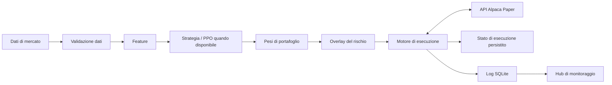
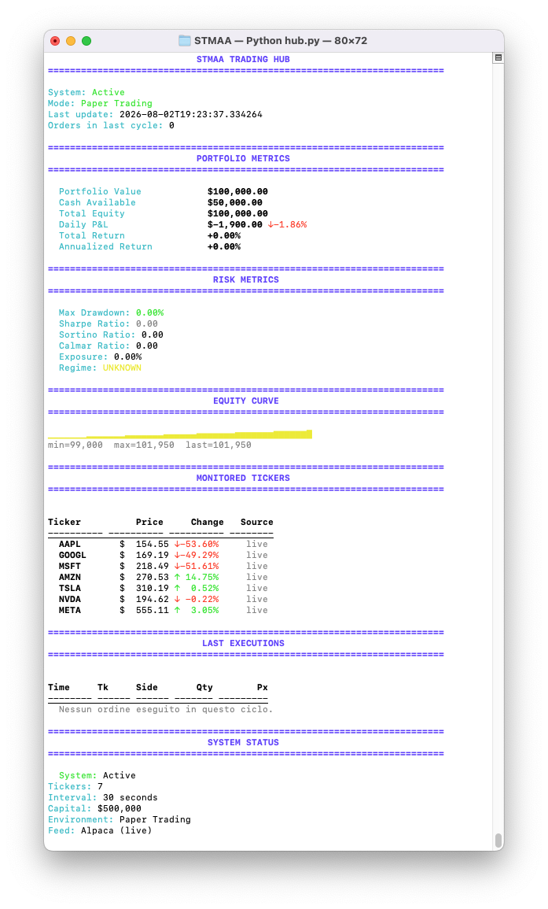

# STMAA — Structural Trading Multi-Agent Architecture

<p align="center">
  
</p>

<p align="center">
  
  
  
  <a href="https://github.com/iFabbro/STMAA/actions/workflows/ci.yml"></a>
  
</p>

STMAA è un framework modulare e sperimentale per la ricerca sul trading sistematico, la generazione dei pesi di portafoglio, il backtesting, i controlli del rischio e l'integrazione con il broker. L'architettura separa la validazione dei dati di mercato, l'elaborazione delle variabili, la generazione delle strategie, i filtri di rischio, l'esecuzione, la persistenza dello stato e il monitoraggio operativo.

**Ambito attuale: ricerca e Alpaca Paper Trading. STMAA non è certificato né presentato come software pronto per la produzione; il punto di ingresso operativo incluso nel repository è configurato esclusivamente per il paper trading.** Il superamento dei test non dimostra la redditività, non elimina i rischi di esecuzione e non certifica l'idoneità a operare con capitale reale.

## Funzionalità attuali

- **Interfaccia basata sui pesi:** le strategie esprimono le allocazioni obiettivo tramite pesi di portafoglio.
- **Integrazione dei dati di mercato:** accesso a barre storiche e quotazioni recenti tramite Alpaca, con controlli pensati per individuare dati mancanti, malformati, incompleti o obsoleti.
- **Controlli del rischio:** vincoli sull'esposizione di portafoglio e delle singole posizioni, controlli relativi al drawdown e logica di overlay del rischio basata sul VIX.
- **Protezioni nell'esecuzione tramite broker:** verifiche sull'account, sugli ordini aperti o pendenti, sulla coerenza tra ordini e posizioni e sui dati necessari a stimare l'esposizione. Quando lo stato necessario non è affidabile, i percorsi interessati sono progettati per bloccare l'operazione invece di inviare un nuovo ordine.
- **Riconciliazione degli ordini:** controlli per gestire aggiornamenti ritardati delle posizioni dopo l'esecuzione, inclusi i riempimenti parziali e le discrepanze non risolte.
- **Persistenza dello stato di esecuzione:** gestione dello stato locale con protezioni per la scrittura atomica, blocco dei processi concorrenti e verifiche contro scritture obsolete.
- **Componenti di backtesting:** motore di ricerca per il backtesting e interfacce condivise basate sui pesi.
- **Visibilità operativa:** registrazione di eventi e sessioni tramite SQLite e dashboard Textual da terminale. Overview e System mostrano snapshot e cronologia locale; Portfolio mostra esclusivamente le posizioni contenute nello snapshot persistito; Orders & Executions mostra separatamente le evidenze persistite del broker executor.
- **Test di regressione automatizzati:** copertura di strategie, dati, esecuzione, rischio e scenari di errore.

Queste descrizioni riguardano funzionalità presenti nel codice; non garantiscono che ogni possibile errore di mercato, broker, rete o processo sia coperto. Prima di fare affidamento su un comportamento, esaminare il codice e i risultati CI più recenti.

## Dashboard terminale: stato e scritture locali

La dashboard Textual legge le fonti locali tramite i provider read-only in `src/dashboard/local_providers.py`. Overview distingue lo snapshot JSON dall'ultimo snapshot SQLite; System mostra disponibilità delle fonti, metadati dell'ultima run e una pagina limitata di eventi recenti. Portfolio mostra soltanto le posizioni contenute nello snapshot di monitoraggio persistito, con provenienza e timestamp: non interroga il broker e non garantisce che le posizioni siano attuali. Orders & Executions legge `logs/execution/broker_state.json` (o il percorso configurato da `STMAA_BROKER_STATE_FILE`) e presenta in sezioni distinte gli intenti di submission non risolti, gli ordini confermati persistiti, i batch OPG e gli stati delle liquidazioni di emergenza (pending e unresolved). Questo file contiene evidenza locale storica dell'ultima persistenza, non un registro live degli ordini, dei fill o dello stato corrente del broker. Uno stato mancante, non valido o non leggibile viene mostrato come sconosciuto/non disponibile; non viene convertito in una collezione vuota.

**La dashboard non è un processo zero-write.** `hub.py` conserva le scritture di audit della propria sessione tramite `start_run()`, `log_event()` ed `end_run()`. In particolare, `start_run()` usa il lifecycle SQLite esistente, che può inizializzare il database e recuperare sessioni orfane. Queste operazioni sono separate dai provider: lettura, refresh e rendering dei provider non devono scrivere, migrare, recuperare o modificare dati. Nessuna di queste operazioni di audit implica una chiamata al broker o l'invio di ordini.

## Architettura



Il repository contiene codice relativo a PPO, ma la presenza di un agente o di dipendenze per l'addestramento non dimostra che esista un modello addestrato, validato o redditizio. La qualità del modello e le prestazioni della strategia richiedono valutazioni separate.

## Sicurezza e limiti operativi

- Il file `.env.example` configura `STMAA_TRADING_MODE=paper` e l'endpoint API di Alpaca Paper.
- Il punto di ingresso `trade.py` costruisce il broker executor con il paper trading abilitato.
- La configurazione del rischio include `MAX_PORTFOLIO_EXPOSURE` (valore predefinito `0.50`) e `MAX_DRAWDOWN` (valore predefinito `0.15`); i valori vengono validati all'avvio. Altri controlli sono configurati nei moduli di strategia ed esecuzione pertinenti.
- Il limite operativo di esposizione nozionale lorda è fissato a **1.000 USD**, condiviso tra DAY e OPG. Somma il valore lordo delle posizioni aperte e le riserve degli ordini BUY pendenti, inclusi quelli parzialmente eseguiti; il nuovo BUY viene ridotto o bloccato se supererebbe il limite. Le SELL di riduzione restano consentite e gli ordini SELL pendenti non vengono conteggiati come nuova esposizione. I BUY DAY sono inviati come limit order al prezzo della quotazione verificata, così il fill non può superare il prezzo usato per il sizing. Nel preflight OPG le SELL pianificate non vengono sottratte prima del fill: un batch misto può inviare BUY soltanto se posizioni correnti, BUY pendenti e nuovi BUY restano già entro 1.000 USD. Dati di posizione, prezzi, lato o stato ordine non determinabili bloccano fail-closed le nuove esposizioni. Il limite è indipendente dal capitale strategico di riferimento.
- Il percorso di esecuzione include controlli fail-closed per importanti condizioni di errore o indeterminatezza relative a broker, ordini, posizioni, dati di mercato e stato persistito.
- La liquidazione di emergenza al superamento della soglia di drawdown è opzionale e, nel file `.env.example`, è disabilitata per impostazione predefinita.
- Molti scenari di errore vengono verificati tramite mock e stato locale. Un test superato con mock non prova il comportamento end-to-end del broker in tutte le condizioni reali.

**Non configurare questo progetto per un account di broker live e non usarlo per negoziare fondi reali basandosi soltanto su questo README.** Un eventuale supporto futuro al live trading richiederebbe una revisione separata dell'implementazione, protezioni esplicite, test operativi e una validazione indipendente del rischio.

## Demo

<p align="center">
  
</p>

## Requisiti

- Python 3.12.
- Git.
- [uv](https://docs.astral.sh/uv/) per risolvere e installare le dipendenze dal lock file.
- Credenziali Alpaca Paper Trading per i flussi che richiedono dati di mercato o accesso al broker.

Il repository usa `pyproject.toml` per dichiarare le dipendenze dirette e `uv.lock` per bloccare le versioni risolte, incluse quelle transitive. Il lock file è condiviso tra le piattaforme supportate; `uv` seleziona i pacchetti compatibili con il sistema operativo e l'architettura.

## Avvio rapido

Clonare il repository e installare le dipendenze runtime in un ambiente isolato:

```bash
git clone https://github.com/iFabbro/STMAA.git
cd STMAA
uv sync --locked
```

Per installare anche le dipendenze di sviluppo e test:

```bash
uv sync --locked --group dev
```

Per aggiornare intenzionalmente il lock file dopo una modifica alle dipendenze:

```bash
uv lock
uv sync --locked --group dev
```

Non usare `uv lock --upgrade` come aggiornamento automatico ordinario: aggiorna le versioni solo nell'ambito di una modifica deliberata e revisionata.

Creare un file di configurazione locale a partire dal modello:

```bash
cp .env.example .env
```

Inserire in `.env` le credenziali API di **Alpaca Paper Trading**. Non salvare credenziali o altri segreti nel repository. Mantenere la modalità paper e l'endpoint paper, salvo modifiche esplicitamente revisionate.

Eseguire la suite di test usando l'ambiente bloccato:

```bash
uv run --locked pytest src/tests tests -q
uv pip check
```

### Addestramento PPO (ricerca, non paper execution)

Il training PPO è un'attività di ricerca separata dal ciclo di paper trading. Usa lo stesso contratto versionato dell'inferenza:

Il capitale strategico predefinito è **100.000 USD** (`STMAA_INITIAL_CAPITAL`), coerente con l'equity dell'account Alpaca Paper di riferimento attualmente adottato per lo sviluppo. Può essere sovrascritto tramite `.env` o `--initial-capital` durante il training. Questo valore è la base di calcolo della strategia: **non costituisce un limite operativo agli ordini**. Il limite operativo separato del percorso DAY/OPG è fissato a 1.000 USD di esposizione nozionale lorda aggregata.

- **Contratto modello:** versione `7`.
- **Contratto osservazioni:** `dimensionless_ohlc_features_v1`. Per ogni ticker la policy riceve rendimento close-to-close a una barra, RSI centrato, MACD/Close, Close/BB_middle - 1 e ATR/Close; il vettore include inoltre liquidità e pesi correnti.
- **Contratto dati:** versione `4`, barre giornaliere Alpaca SIP consolidate con `adjustment=all`, campi OHLCV e campo `Open` richiesto per l'esecuzione al successivo open.
- **Esecuzione simulata:** il segnale è calcolato sulla barra completata (t) e il nuovo target è applicato all'Open della barra (t+1). Le posizioni preesistenti assorbono il gap overnight; il nuovo target parte dall'open successivo. Costi e slippage sono applicati nel modello di ambiente.
- **Separazione temporale:** il periodo più recente è riservato alla validazione cronologica e non viene usato per l'ottimizzazione PPO.

Esempio di training esplicito:

```bash
uv run --locked python train.py \
  --start-date 2018-01-01 \
  --end-date 2026-01-01 \
  --total-timesteps 50000 \
  --validation-fraction 0.2 \
  --max-position-size 0.20 \
  --max-gross-exposure 0.50 \
  --transaction-cost 0.001 \
  --slippage 0.0005 \
  --learning-rate 0.0003 \
  --n-steps 2048 \
  --batch-size 64 \
  --n-epochs 10 \
  --gamma 0.99 \
  --seed 42 \
  --include-timeseries
```

`--end-date` è esclusiva. Il percorso base predefinito è `models/ppo_trading_model.zip`; può essere cambiato con `--model-path`. Il percorso base non è il file binario pubblicato: dopo il salvataggio il sistema produce un artefatto immutabile con nome content-addressed, `ppo_trading_model.<sha256>.zip`, e un manifest attivo `ppo_trading_model.zip.metadata.json`. Il manifest punta all'artefatto esatto tramite nome e SHA-256. I file temporanei vengono preparati nella stessa directory; il manifest viene pubblicato atomicamente dopo l'artefatto. Non rinominare o modificare manualmente questi file.

Il manifest registra: versione del contratto modello, ticker e dimensione dello stato, contratti di azione/esecuzione/osservazione, costi e limiti, contratto dati completo, SHA-256 dell'artefatto, nome dell'artefatto e metadati di training (fonte dati, intervalli training/validation, frazione holdout, timesteps, seed e metriche di validazione). La specifica dei campi e il relativo JSON Schema sono in [`docs/PPO_ARTIFACTS.md`](docs/PPO_ARTIFACTS.md) e [`docs/schemas/ppo-artifact-manifest.schema.json`](docs/schemas/ppo-artifact-manifest.schema.json).

Il caricamento verifica la compatibilità dei contratti, dei parametri, del nome content-addressed e dell'hash prima di deserializzare il modello. Gli artefatti PPO v6 o con semantica delle osservazioni precedente non sono compatibili con v7: devono essere rigenerati con un nuovo training controllato. La manutenzione degli artefatti è esplicita e il pruning è dry-run per impostazione predefinita.

La validazione holdout è diagnostica e non applica una soglia automatica di redditività. Un risultato positivo non garantisce prestazioni future. Il training effettua richieste autenticate all'API di mercato Alpaca tramite `StockHistoricalDataClient` per scaricare lo storico SIP; richiede quindi credenziali Alpaca abilitate all'accesso ai dati richiesti. Non usa il client di trading, non legge né modifica lo stato dell'account, non invia, cancella o modifica ordini e non avvia il ciclo operativo Paper. Non viene eseguito automaticamente all'avvio di `trade.py`. Non è incluso nel repository alcun modello pre-addestrato: il download del codice non equivale al download di un artefatto PPO già addestrato. La generazione del modello richiede un training eseguito separatamente.

Il manifest registra inoltre i parametri PPO effettivi (`learning_rate`, `n_steps`, `batch_size`, `n_epochs`, `gamma`), il capitale iniziale, il seed, l'hash SHA-256 del dataset processato effettivamente passato al training e il commit Git sorgente quando il comando viene eseguito in un checkout Git. Registra anche se il working tree Git è pulito: un commit identificato con modifiche locali non committate non descrive da solo l'intero codice effettivamente eseguito. Se Git non è disponibile, i campi di provenienza Git sono `null`. L'hash identifica valori, colonne e timestamp della matrice di feature dopo pulizia e calcolo degli indicatori; non sostituisce l'archiviazione del dataset. Se il codice viene eseguito da un archivio privo di metadati Git, `git_commit` è `null`.

Per avviare il flusso Alpaca Paper dopo aver generato e verificato un modello compatibile:

```bash
uv run --locked python trade.py
```

#### Preflight operativo senza avviare il ciclo

Per verificare la configurazione e l'accesso all'account Alpaca Paper senza avviare il ciclo di trading:

```bash
uv run --locked python trade.py --preflight-only
```

Questa modalità richiede credenziali Alpaca Paper valide e un account raggiungibile. Esegue la validazione locale della configurazione e acquisisce snapshot read-only di account, posizioni e ordini aperti; riconcilia inoltre le submission DAY e i batch OPG persistiti usando evidenza del broker. Calcola l'esposizione nozionale lorda aggregata (posizioni più riserve BUY pendenti) e la confronta con il limite operativo di **1.000 USD**. Il report indica separatamente se il broker è riconciliato e se una nuova decisione sarebbe consentita. Se esistono ordini aperti/irrisolti o l'esposizione supera il limite, il comando termina con codice di uscita `2` e segnala il blocco: non tenta di correggere la situazione.

Il preflight non avvia il polling, non carica né richiede un modello PPO e non invia, modifica, sostituisce, cancella o chiude ordini. La riconciliazione può aggiornare metadati e stato locale persistito, ma le chiamate al broker restano di lettura. Gli snapshot Alpaca non sono atomici tra endpoint: il report è una fotografia diagnostica del momento, non una garanzia che lo stato non cambi subito dopo. Un esito senza blocchi non autorizza automaticamente un test con ordini e non dimostra che il ciclo Paper completo possa essere eseguito.

Avviare l'hub di monitoraggio da terminale in una finestra separata:

```bash
uv run --locked python hub.py
```

L'avvio corretto non dimostra che la strategia sia redditizia né che tutti gli scenari di esecuzione siano stati validati. STMAA resta alpha/sperimentale e non va configurato per operare con capitale reale.

### Validazione PPO walk-forward

Per valutare la robustezza temporale oltre il singolo holdout cronologico, è disponibile una validazione expanding-window:

```bash
uv run --locked python walk_forward.py \
  --start-date 2018-01-01 \
  --end-date 2026-01-01 \
  --min-train-observations 756 \
  --test-observations 126 \
  --total-timesteps 50000 \
  --seed 42
```

Ogni fold addestra un nuovo agente PPO soltanto sul periodo precedente e valuta il modello sul successivo intervallo non sovrapposto. I parametri restano fissi durante l'esecuzione; i risultati OOS non devono essere usati per ottimizzarli. Il report JSON viene scritto in `reports/` oppure nel percorso indicato da `--report-path`.

I fold partono ciascuno da capitale indipendente in liquidità: i risultati sono quindi diagnostici per fold e non vengono concatenati in una curva patrimoniale continua. La metodologia, i limiti e i dettagli sono descritti in [docs/PPO_WALK_FORWARD.md](docs/PPO_WALK_FORWARD.md). Questa valutazione non invia ordini e non usa il client di trading Alpaca.

Per ripetere gli stessi fold con più inizializzazioni PPO, usare
`--seeds` (ad esempio `--seeds 11 22 33 44 55`). Il report conserva i
risultati per ogni seed/fold e aggiunge media, mediana, deviazione standard,
minimo e massimo delle metriche numeriche, sia complessivamente sia per fold.
Metriche non definite non vengono convertite in zero. Le statistiche descrivono
run indipendenti: i rendimenti non vengono concatenati o composti in una curva
patrimoniale continua. Dettagli: [docs/PPO_WALK_FORWARD.md](docs/PPO_WALK_FORWARD.md).

### Benchmark PPO versus equal-weight buy-and-hold

Per confrontare il PPO walk-forward con una baseline passiva senza riaddestrare
gli agenti, usare il report JSON già prodotto da `walk_forward.py`:

```bash
uv run --locked python benchmark_walk_forward.py \
  --ppo-report reports/ppo_walk_forward_20261109.json \
  --start-date 2018-01-01 \
  --end-date 2026-01-01 \
  --report-path reports/ppo_benchmark_comparison_20261109.json \
  --include-timeseries
```

Il benchmark equal-weight usa gli stessi fold OOS, capitale, costi, slippage e limiti di
esposizione del report PPO. Parte in liquidità, entra all'Open della seconda
barra del fold (come il valutatore PPO), acquista a peso uguale e mantiene le
quote senza ribilanciamento. Il report aggiunge SPY come serie separata dall'universo PPO, con due simulazioni buy-and-hold: esposizione fissa al 50% (riferimento
a esposizione comparabile) e al 100% (riferimento di mercato non scalato). Per
SPY non si applica il limite del 20% per singola posizione, perché è un solo ETF;
entrambi gli scenari usano ingresso al successivo Open e gli stessi costi e
slippage. Il report confronta le metriche per fold; le
simulazioni restano indipendenti e non costituiscono una curva patrimoniale
continua. La metodologia è descritta in [docs/PPO_BENCHMARK.md](docs/PPO_BENCHMARK.md).

### Confronto multi-seed: risultati e limiti (10 novembre 2026)

L'analisi descrittiva completata usa 3 inizializzazioni PPO (seed 42, 7 e 21) sugli stessi 11 fold walk-forward: 33 valutazioni seed/fold, ma soltanto 11 periodi di mercato distinti. Il dataset analizzato comprendeva 7 ticker, dal 30 gennaio 2018 al 6 novembre 2026, per 2.206 osservazioni. Le inizializzazioni multiple misurano la sensibilità alla casualità del training; non moltiplicano il numero di periodi OOS indipendenti.

| Indicatore | Risultato descrittivo |
|---|---:|
| Fold con rendimento netto positivo | 24/33 (72,7%) |
| Rendimento netto medio per fold | +3,5535% |
| Rendimento netto mediano per fold | +4,5912% |
| Intervallo dei rendimenti | -15,6523% / +19,0003% |
| Drawdown medio per fold, aggregato descrittivo | circa -9,48% |
| Peggior drawdown osservato | -27,1549% |

Le medie dei rendimenti per seed sono: +5,6436% (seed 42), +2,9976% (seed 7) e +2,0193% (seed 21). Le medie Sharpe per seed sono rispettivamente 0,976, 0,675 e 0,419; le medie Sortino sono 1,524, 1,147 e 0,624. La volatilità annualizzata media per seed è compresa tra 13,68% e 14,45%. Questi valori sono medie aritmetiche di metriche calcolate separatamente per fold: non sono metriche di un portafoglio aggregato e non devono essere interpretati come un track record composto.

Ogni fold parte da capitale indipendente in liquidità (capitale iniziale di riferimento 100.000 USD) e contiene 125 periodi giornalieri. Il CAGR riportato per fold è un'annualizzazione matematica di un intervallo di circa sei mesi, non un rendimento annuo effettivamente osservato. I costi sono già detratti dall'equity nel simulatore: non devono essere sottratti una seconda volta. Le ipotesi di commissione e slippage restano un modello, non una misura garantita dei costi reali di mercato, spread e market impact.

Il confronto benchmark resta diagnostico: nei 33 confronti seed/fold, equal-weight ha superato il rendimento PPO in 19 casi; SPY al 50% in 14 casi; SPY al 100% in 23 casi. Questi conteggi non sono voti statistici indipendenti. SPY al 100% è un riferimento di mercato non scalato, non un confronto a rischio equivalente. Il benchmark exposure-matched equal-weight richiede le tracce giornaliere PPO: è disponibile per report single-seed con trace completa. Nel report multi-seed è intenzionalmente INCONCLUSIVE, perché usare un'unica traiettoria di esposizione per seed diversi falserebbe il confronto.

**Esito della valutazione:** il campione mostra un segnale storico positivo netto, ma non dimostra ancora una redditività robusta né compatibilità con il profilo di rischio previsto. Il peggior drawdown osservato (-27,15%) supera il limite configurato del 15%. Poiché la liquidazione automatica al drawdown è disabilitata per impostazione predefinita, il valore configurato non va descritto come uno stop-loss effettivamente applicato. La multi-seed è quindi un'analisi descrittiva completata, non un PASS di validazione.

### Protocollo holdout finale: stato e regole

I periodi walk-forward e multi-seed già esaminati durante lo sviluppo non sono più un holdout finale intatto. Non si deve rinominare retroattivamente come "final holdout" un intervallo già consultato per diagnosi, confronto o decisioni di sviluppo. Se non esiste una finestra storica documentata come mai ispezionata, la validazione finale dovrà essere prospettica.

Prima di iniziare la raccolta prospettica, il protocollo richiede di congelare e registrare:

1. commit Git e stato pulito del working tree;
2. file modello content-addressed, SHA-256 e manifest;
3. seed/modello selezionato prima dell'inizio, senza scegliere a posteriori il seed con il miglior risultato;
4. universo ticker, contratti dati/feature e feed;
5. parametri PPO, capitale simulato, limiti di posizione/esposizione e regole di esecuzione;
6. costi e slippage di base, più scenari di sensibilità predefiniti;
7. metriche, benchmark e criteri di valutazione.

La finestra prospettica raccomandata è di 252 sedute NYSE completate. Un'eventuale lettura intermedia può controllare soltanto integrità dei dati, disponibilità del processo e correttezza della raccolta; non deve essere usata per cambiare modello, parametri o criteri. Se si interrompe il protocollo per un difetto tecnico, l'interruzione e la causa devono essere registrate prima di decidere se ripartire.

La valutazione finale deve riportare rendimento totale netto dei costi, drawdown massimo, volatilità, Sharpe/Sortino, esposizione, turnover, costi e confronto con equal-weight, SPY 50%, SPY 100% e, quando metodologicamente disponibile, equal-weight a esposizione PPO abbinata. Criteri preliminari: rendimento netto positivo e drawdown massimo non superiore al 15%; le altre metriche sono diagnostiche e vanno lette insieme, non isolate. Il superamento di questi criteri non garantisce risultati futuri.

La raccolta prospettica è inizialmente **shadow/read-only**: nessun ordine viene inviato, cancellato o modificato per effetto del protocollo. Un eventuale test con ordini Alpaca Paper richiederà un'autorizzazione separata e limiti operativi espliciti. Il protocollo non autorizza in alcun modo operazioni live.

### Qualità delle quotazioni (monitoraggio)

Gli snapshot espongono età, spread assoluto/percentuale e stato qualitativo
(ok, stale, future_timestamp, wide_spread, clock_skew, missing, invalid o
unavailable). Le soglie predefinite sono 1.200 secondi per la freschezza
(compatibili con delayed SIP), 5 secondi di tolleranza per timestamp futuri e
2% per segnalare spread ampi. Sono configurabili tramite
STMAA_QUOTE_MAX_AGE_SECONDS, STMAA_QUOTE_FUTURE_TOLERANCE_SECONDS e
STMAA_QUOTE_WIDE_SPREAD_PCT.

Il feed delle barre storiche e quello delle quotazioni recenti sono configurazioni distinte: `DATA_FEED` governa le barre strategiche (SIP), mentre `DATA_QUOTE_FEED` governa le quotazioni (delayed SIP nella configurazione attuale). La telemetria distingue la sorgente della quotazione e controlla freschezza, timestamp futuri e spread; il confronto con IEX è diagnostico e non sostituisce il feed SIP del contratto PPO. Un dato obsoleto o incoerente deve restare visibile come tale e non essere interpretato come prova di freschezza del feed.

I campi sono esclusivamente diagnostici: non modificano il prezzo medio,
il contratto dati PPO, i manifest, i segnali, i pesi, il risk overlay o il
percorso di esecuzione. Non costituiscono un filtro ordini.

### Feed dati Alpaca e ritardo

Il contratto versionato del modello usa barre giornaliere consolidate **SIP** con
`adjustment=all` per training e inferenza. Il feed IEX non viene usato per
costruire lo storico del modello, perché la sua copertura non garantisce tutte
le sedute NYSE richieste dal controllo di completezza.

Per le quotazioni recenti, l'adapter richiede il feed **delayed SIP** quando
l'endpoint delle ultime quotazioni lo supporta. Le barre storiche continuano a
usare il feed `sip`: `delayed_sip` non è supportato dall'endpoint storico
delle barre. Sul piano gratuito le richieste storiche SIP devono rispettare il
ritardo previsto da Alpaca; l'adapter applica un margine temporale e, durante
una sessione NYSE in corso, esclude la barra giornaliera parziale della sessione
corrente.

Il passaggio da IEX a SIP incrementa la versione del contratto dati. I modelli
salvati con il precedente contratto IEX non sono compatibili: occorre
riaddestrarli e verificare i nuovi metadati prima di caricarli. Questo cambio
non dimostra la qualità predittiva del modello e non abilita il live trading.

### Frequenza di polling e decisione giornaliera

`STMAA_INTERVAL_SECONDS` (default `300`) determina la frequenza con cui il processo controlla i dati e lo stato del broker; **non** determina la frequenza delle decisioni PPO. Il feed strategico usa barre giornaliere: il sistema registra in modo persistente il timestamp UTC della barra e consente al massimo una decisione PPO per barra valida. Le iterazioni successive sulla stessa barra non rigenerano i pesi e non inviano nuove submission.

A ogni polling il broker executor continua le verifiche operative read-only su submission irrisolte, ordini confermati, riconciliazione delle posizioni e ordini aperti. Un ordine attivo o non riconciliato blocca una nuova decisione su una barra successiva, ma non interrompe il monitoraggio periodico.

La prenotazione della decisione viene salvata prima dell'inferenza. Se il processo si interrompe prima del completamento persistito, il ciclo resta bloccato: al riavvio STMAA tenta esclusivamente la riconciliazione read-only degli ordini e delle posizioni. Se l'evidenza del broker non è conclusiva, non viene effettuata una nuova submission. La barra interrotta resta consumata anche dopo una riconciliazione riuscita. Uno stato broker preesistente con storico di esecuzione ma senza il nuovo marcatore giornaliero richiede una verifica manuale dell'operatore e non viene azzerato automaticamente.

### Esecuzione MOO/OPG pianificata (Paper)

Il percorso MOO/OPG è un'opzione esplicita e separata dal percorso DAY esistente. Per avviarlo:

```bash
uv run --locked python trade.py --execution-mode opg
```

Senza `--execution-mode opg`, `trade.py` mantiene il percorso DAY predefinito. La modalità OPG non effettua fallback automatici al percorso DAY.

Il ciclo OPG usa la barra giornaliera completata come segnale e risolve la sessione successiva tramite il calendario XNYS. La finestra prevista è dalle **19:00 ET della sessione del segnale alle 09:25 ET della sessione target**. Prima dell'apertura della finestra il processo attende; dalle 09:25 ET in poi il segnale è considerato mancato e non viene recuperato né spostato automaticamente a una sessione successiva. Gli orari sono basati su `America/New_York`, quindi seguono automaticamente il cambio tra ora solare e legale.

Durante la finestra:
1. STMAA genera i pesi PPO e applica i controlli del risk overlay già previsti dal ciclo Paper.
2. Il piano OPG converte i target in quantità intere, usando come capitale di sizing il minore tra equity effettiva verificata e limite operativo aggregato di 1.000 USD, insieme al Close della barra completata. L'equity effettiva resta la base per l'inferenza PPO e per i controlli di drawdown; il capitale di sizing limita invece il controvalore degli ordini. Le quantità correnti sono lette dal broker; posizioni short, frazionarie o non modellate bloccano il piano.
3. Sotto il broker execution lock, il preflight legge nuovamente account, posizioni e ordini Paper e verifica identità dell'account, stato operativo, coerenza delle quantità, idoneità degli asset, budget BUY e limite aggregato di 1.000 USD.
4. Solo dopo il preflight approvato, STMAA persiste il batch e le intenzioni d'ordine, quindi invia i BUY come limit-on-open (LOO), con limit price pari al Close usato per il sizing, e le SELL come market-on-open (MOO), in sequenza. Il report del preflight viene conservato nel batch come evidenza della verifica.

Il preflight è read-only: non invia, cancella, sostituisce o chiude ordini. I BUY LOO non possono essere eseguiti sopra il Close usato per il sizing; se l'asta apre sopra il limite, l'ordine può non essere eseguito. Le SELL MOO restano ordini market-on-open di riduzione. Gli asset IPO sono esclusi dal percorso market-on-open. Un asset attivo ma non negoziabile può essere ammesso soltanto per una vendita di chiusura coperta da una posizione long verificata. I proventi SELL non vengono conteggiati nel budget BUY.

**Limite di prezzo:** il budget BUY è stimato con il Close della barra del segnale, non con il prezzo dell'asta successiva. Un gap overnight può rendere il costo effettivo superiore alla stima; il preflight non è un limite di prezzo e non garantisce che il broker accetti ogni ordine all'apertura.

Gli identificativi batch e client-order sono deterministici. In caso di esito ambiguo di una submission, il sistema effettua la verifica prevista tramite client-order ID e non ripete alla cieca l'invio. La riconciliazione read-only degli ordini e dei batch OPG prosegue a ogni polling anche fuori dalla finestra di submission. Dopo un riavvio, il recupero è read-only: ordini attivi o parziali e posizioni non riconciliate mantengono il batch bloccante. Non vengono ritentate quantità residue e non vengono recuperate automaticamente le sessioni mancate. Un errore o una verifica inconcludente lascia il ciclo bloccato per riconciliazione; non attiva il percorso DAY come alternativa.

La modalità OPG è **Paper-only**. Richiede un account Alpaca Paper, un modello PPO compatibile già addestrato e verificato, feed dati validi e un processo STMAA attivo durante la finestra di submission. Il codice OPG non rende la strategia redditizia né abilita il trading con capitale reale.

## Struttura del repository

```text
.
├── src/
│   ├── agents/       # Componenti agent e portafoglio
│   ├── backtest/     # Componenti di backtesting
│   ├── data/         # Accesso ed elaborazione dati di mercato
│   ├── execution/    # Broker executor e protezioni di esecuzione
│   ├── strategy/     # Interfaccia dei pesi e overlay del rischio
│   ├── tests/        # Test di regressione automatizzati
│   └── utils/        # Metriche e logging SQLite
├── tests/            # Test aggiuntivi, se presenti
├── scripts/          # Script di supporto e validazione, se presenti
├── docs/             # Specifiche operative e contratti degli artefatti
├── trade.py          # Punto di ingresso per il paper trading
├── hub.py            # Hub di monitoraggio da terminale
├── train.py          # Punto di ingresso per l'addestramento
├── pyproject.toml
├── uv.lock
├── .env.example      # Modello di configurazione paper
└── ROADMAP.md        # Roadmap: verificare la coerenza con l'implementazione corrente
```

## Installazione e verifica su macOS

Su macOS 12.7 o successivo, installare una versione di Python 3.12 compatibile con l'architettura del Mac e installare `uv`. Dalla directory del repository eseguire:

```bash
uv sync --locked
uv run --locked python -c "import alpaca; import gymnasium; import numpy; import pandas; import stable_baselines3; import torch"
uv pip check
```

Per verificare anche i test e gli strumenti di sviluppo:

```bash
uv sync --locked --group dev
uv run --locked pytest src/tests tests -q
uv run --locked ruff check .
uv run --locked python doctor.py
```

`doctor.py` verifica localmente Python 3.12, presenza del lock file, disponibilità di `uv`,
dipendenze runtime e configurazione Paper. Non effettua richieste di rete, non contatta Alpaca,
non legge lo stato del broker e non invia ordini. Le credenziali mancanti sono segnalate come
avviso perché non servono per test e diagnostica locale; sono necessarie soltanto per i flussi
che si collegano ad Alpaca. Un esito senza errori non sostituisce il preflight read-only
dell'account Paper.

Il test di installazione pulita riproducibile è eseguito dalla CI su Linux, macOS Intel e
Apple Silicon: checkout pulito, installazione con `uv sync --locked --group dev`,
controllo dipendenze, suite completa e Ruff. Sul Mac locale, eseguire i comandi sopra in un
clone aggiornato; non eliminare `.env`, `logs/` o `models/` per simulare una nuova installazione.

Il progetto usa un'unica base di codice e un unico lock file per le architetture Intel (x86_64) e Apple Silicon (arm64): non esistono fork del codice per Mac vecchi e recenti. Il lock file fissa PyTorch 2.2.2 e Stable-Baselines3 2.3.2 per mantenere la compatibilità con i wheel macOS Intel; la stessa combinazione viene verificata anche su Apple Silicon. Il supporto a versioni future di PyTorch richiederà una nuova verifica esplicita della disponibilità di wheel x86_64 e dei contratti PPO. La verifica locale sopra riportata resta necessaria sul computer di destinazione. Il recupero delle sessioni orfane usa il timestamp di avvio del processo fornito dal kernel: Linux tramite `/proc` e macOS tramite `proc_pidinfo(PROC_PIDTBSDINFO)`. Se il sistema operativo non consente di verificare l'identità, STMAA lascia la sessione invariata (fail-closed).

## Integrazione continua

Il workflow GitHub Actions esegue l'intera suite di test su Linux, macOS Intel (`macos-15-intel`) e Apple Silicon (`macos-15`). I test di identità dei processi e recupero delle sessioni orfane vengono eseguiti su tutte e tre le piattaforme, senza esclusioni specifiche per macOS. CI controlla inoltre la coerenza delle dipendenze ed esegue Ruff. Il lock file è verificato con `uv lock --check`; le installazioni CI usano `uv sync --locked`.

## Stato dello sviluppo e verifiche (11 novembre 2026)

STMAA rimane in stato **alpha / sperimentale**. Le fasi di hardening architetturale, consolidamento dei controlli di rischio/esecuzione e riproducibilità dell'installazione sono completate a livello di codice e test. Questo stato non equivale a una validazione operativa end-to-end né dimostra redditività o idoneità alla produzione.

| Fase | Stato | Evidenza e limiti |
|---|---|---|
| 1 — Hardening architetturale e Paper-only | Completata a livello di codice/test | Guardie Paper-only, controlli di freschezza e qualità dei dati, telemetria SIP/IEX e raccolta shadow predisposta. Non equivale a una prova operativa prolungata. |
| 2 — Rischio ed esecuzione | Completata a livello di codice/test | Controlli fail-closed, riconciliazione, protezioni dell'executor e test degli scenari di errore. I test mock/locali non sostituiscono una validazione end-to-end contro il broker. |
| 3 — Installabilità e riproducibilità | Completata | Doctor offline, lock file e istruzioni clean-install. Su macOS 12.7.6 Intel, un clone pulito ha completato `uv sync --locked`; `doctor.py` ha riportato 5 PASS, 1 WARN atteso e 0 FAIL perché il clone isolato non conteneva `.env`; la suite ha superato **1.449 test** in 187,30 secondi. |
| 4 — Validazione end-to-end locale su macOS | In corso | Il checkout principale è allineato al commit `663feeec8c253c9c1955d9572b6a45220056b7f5`, con working tree pulito. Il Doctor locale ha riportato **8 PASS, 0 WARN, 0 FAIL**, inclusa la configurazione Paper e la presenza dei campi credenziali. Restano da verificare i flussi locali e la dashboard nel checkout aggiornato. |
| 5 — Raccolta shadow prospettica | Da avviare dopo la Fase 4 | La raccolta iniziale è read-only: nessun ordine deve essere inviato, modificato o cancellato. Eventuali test con ordini Alpaca Paper richiedono un'autorizzazione separata ed esplicita. |

### Interpretazione delle verifiche

Il comando `doctor.py` è una diagnostica **offline**: controlla la configurazione locale e la presenza dei campi credenziali, ma non autentica le chiavi, non contatta Alpaca e non verifica la raggiungibilità dell'account. Un esito positivo non sostituisce il preflight read-only del broker.

Il warning `.env` nel clone pulito è atteso: il file contiene configurazione e credenziali locali e non deve essere copiato nel repository. Nel checkout operativo dell'utente il Doctor ha rilevato la configurazione Paper completa. Non pubblicare mai il contenuto di `.env`, chiavi API, token o altri segreti.

La suite automatizzata superata, la CI verde e l'installazione pulita verificano rispettivamente regressioni coperte dai test, compatibilità sulle piattaforme CI e riproducibilità dell'ambiente. Nessuno di questi risultati dimostra da solo il corretto comportamento di ogni flusso contro un account Alpaca reale, neppure in Paper.

La Fase 4 deve quindi completare le verifiche locali di avvio, dashboard, lettura dello stato e comportamento fail-closed senza introdurre operazioni broker non autorizzate. La Fase 5 dovrà usare un protocollo prospettico congelato e mantenere separati i controlli di integrità della raccolta dalla valutazione delle prestazioni. Reinforcement learning, ottimizzazione del portafoglio ed eventuali capacità future di live trading restano ambiti da valutare separatamente.

## Contribuire

1. Creare un branch dedicato e circoscritto.
2. Aggiungere o aggiornare test di regressione per le modifiche comportamentali, in particolare per gli scenari di errore e quelli in cui non deve essere inviato alcun ordine.
3. Eseguire la suite di test e i controlli pertinenti del repository.
4. Aprire una pull request e verificare i risultati CI prima del merge.

## Licenza

STMAA è distribuito con licenza MIT. Consultare il file [`LICENSE`](LICENSE) per i dettagli.


## Broker execution lock and deployment boundary

The broker execution lock is a host-local operating-system file lock (fcntl.flock).
All cooperating STMAA processes on the same host must use the same
STMAA_BROKER_STATE_FILE path on a filesystem that supports advisory locks.
At startup, configured paths are resolved to canonical absolute paths (including
existing symlink targets) before lock-file names are derived.
Lock acquisition is bounded by STMAA_BROKER_EXECUTION_LOCK_TIMEOUT_SECONDS
(default: 30 seconds); timeout or lock errors stop the execution cycle before
broker mutations are attempted.

This mechanism is not a distributed lock and does not coordinate independent
hosts or filesystems. During the current single-host development phase, operate
only one active STMAA executor per broker account. Multi-host execution requires
a separately designed centralized execution service and is outside the scope of
the current implementation.
