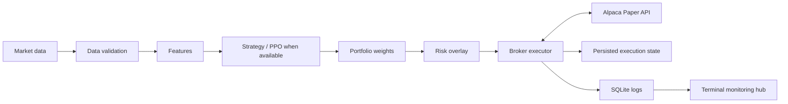

# STMAA — Structural Trading Multi-Agent Architecture

<p align="center">
  
</p>

<p align="center">
  
  
  
  <a href="https://github.com/iFabbro/STMAA/actions/workflows/ci.yml"></a>
  
</p>

STMAA is an experimental, modular framework for systematic-trading research, portfolio-weight generation, backtesting, risk controls, and broker integration. Its design separates market-data validation, feature processing, strategy output, risk overlays, execution, persistence, and operational monitoring.

**Current scope: research and Alpaca Paper Trading. STMAA is not certified or represented as production-ready software, and this repository's trading entry point is configured for paper trading only.** Passing tests does not establish profitability, eliminate execution risk, or certify suitability for live capital.

## Current capabilities

- **Weight-centric strategy interface:** strategies express target allocations as portfolio weights.
- **Market-data integration:** Alpaca historical bars and latest quotes, with validation intended to reject missing, malformed, incomplete, or stale inputs.
- **Risk controls:** portfolio and position exposure constraints, drawdown-related controls, and VIX-aware risk overlay logic.
- **Broker execution safeguards:** checks for account eligibility, pending/open orders, position and order-state consistency, and data needed to estimate exposure. When required state cannot be trusted, execution paths are designed to fail closed rather than submit a new order.
- **Order-state reconciliation:** safeguards for delayed broker position updates after fills, including partial fills and unresolved discrepancies.
- **Persisted execution state:** local state handling with atomic-write protections, process locking, and stale-writer checks.
- **Backtesting components:** a research backtesting engine and shared weight-oriented interfaces.
- **Operational visibility:** SQLite run/event logging and a terminal monitoring hub.
- **Automated regression tests:** coverage for strategy, data, execution, risk, and failure scenarios.

These are implementation-level capabilities, not a guarantee that every market, broker, network, or process failure is covered. Review the code and current CI results before relying on any behavior.

## Architecture



The repository includes PPO-related code, but the presence of an agent or training dependency should not be interpreted as proof of a trained, validated, or profitable model. Model quality and strategy performance require separate evaluation.

## Safety and operating limits

- The supplied `.env.example` configures `STMAA_TRADING_MODE=paper` and the Alpaca Paper API endpoint.
- The `trade.py` entry point constructs the broker executor with paper trading enabled.
- Risk configuration includes `MAX_PORTFOLIO_EXPOSURE` (default `0.50`) and `MAX_DRAWDOWN` (default `0.15`); values are validated at startup. Other risk controls are configured in the relevant strategy/execution modules.
- The execution path contains fail-closed checks for important invalid or indeterminate broker, order, position, market-data, and persistence states.
- Emergency liquidation on drawdown is opt-in and defaults to disabled in `.env.example`.
- Automated tests use mocks and local state for many failure scenarios. A passing mocked test does not prove end-to-end broker behavior in every real-world condition.

**Do not point this project at a live brokerage account or use it to trade real funds based on the README alone.** Any future live-trading support would require a separate implementation review, explicit safeguards, operational testing, and independent risk validation.

## Demo

<p align="center">
  
</p>

## Requirements

- Python 3.13 (the version configured in CI).
- Git.
- Alpaca Paper Trading credentials for workflows that require market data or broker access.

## Quick start

Clone the repository and create an isolated environment:

```bash
git clone https://github.com/iFabbro/STMAA.git
cd STMAA
python3.13 -m venv .venv
source .venv/bin/activate
python -m pip install --upgrade pip
pip install -r requirements.txt
```

Create a local environment file from the example:

```bash
cp .env.example .env
```

Set your **Alpaca Paper Trading** API credentials in `.env`. Do not commit credentials or other secrets. Keep the paper endpoint and paper mode configuration unless you are working on an explicitly reviewed change.

Run the test suite using the same test paths configured in CI:

```bash
python -m pytest src/tests tests -q
```

Start the paper-trading workflow:

```bash
PYTHONPATH=. python trade.py
```

Start the terminal monitoring hub in a separate terminal:

```bash
PYTHONPATH=. python hub.py
```

The trading workflow may require valid credentials and accessible market data. Do not interpret startup success as evidence that a strategy is profitable or that all execution scenarios have been validated.

## Repository map

```text
.
├── src/
│   ├── agents/       # Agent and portfolio-related components
│   ├── backtest/     # Backtesting components
│   ├── data/         # Market-data access and processing
│   ├── execution/    # Broker executor and execution safeguards
│   ├── strategy/     # Weight interface and risk overlay
│   ├── tests/        # Automated regression tests
│   └── utils/        # Metrics and SQLite logging
├── tests/            # Additional tests, when present
├── scripts/          # Helper and validation scripts, when present
├── trade.py          # Paper-trading entry point
├── hub.py            # Terminal monitoring hub
├── train.py          # Training entry point
├── requirements.txt
├── .env.example      # Paper-trading configuration template
└── ROADMAP.md        # Roadmap document; verify against current implementation
```

## Continuous integration

The GitHub Actions workflow at [`.github/workflows/ci.yml`](https://github.com/iFabbro/STMAA/blob/main/.github/workflows/ci.yml) runs the automated test suite on pushes to `main` and pull requests. Check the workflow and the latest run for the authoritative list and status of checks; this README does not claim that a particular commit has passed CI.

## Development status

STMAA remains in **alpha / experimental** status. Active work includes end-to-end audit coverage, broker-state reconciliation, risk calculations under incomplete or stale inputs, and the separation of implemented behavior from future research goals. Reinforcement learning, portfolio optimization, and any future live-trading capability must be evaluated on their own merits; they are not implied to be production-ready by the repository structure.

## Contributing

1. Create a focused feature branch.
2. Add or update regression tests for behavior changes, especially failure and no-order cases.
3. Run the test suite and relevant repository checks.
4. Open a pull request and review the CI results before merging.

## License

STMAA is released under the MIT License. See [`LICENSE`](LICENSE) for details.
