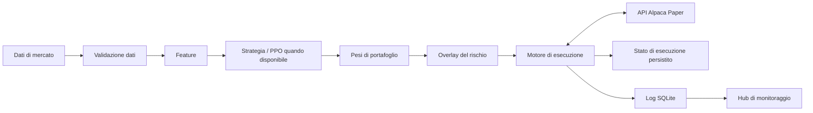

# STMAA — Structural Trading Multi-Agent Architecture

<p align="center">
  
</p>

<p align="center">
  
  
  
  <a href="https://github.com/iFabbro/STMAA/actions/workflows/ci.yml"></a>
  
</p>

STMAA è un framework modulare e sperimentale per la ricerca sul trading sistematico, la generazione dei pesi di portafoglio, il backtesting, i controlli del rischio e l'integrazione con il broker. L'architettura separa la validazione dei dati di mercato, l'elaborazione delle variabili, la generazione delle strategie, i filtri di rischio, l'esecuzione, la persistenza dello stato e il monitoraggio operativo.

**Ambito attuale: ricerca e Alpaca Paper Trading. STMAA non è certificato né presentato come software pronto per la produzione; il punto di ingresso operativo incluso nel repository è configurato esclusivamente per il paper trading.** Il superamento dei test non dimostra la redditività, non elimina i rischi di esecuzione e non certifica l'idoneità a operare con capitale reale.

## Funzionalità attuali

- **Interfaccia basata sui pesi:** le strategie esprimono le allocazioni obiettivo tramite pesi di portafoglio.
- **Integrazione dei dati di mercato:** accesso a barre storiche e quotazioni recenti tramite Alpaca, con controlli pensati per individuare dati mancanti, malformati, incompleti o obsoleti.
- **Controlli del rischio:** vincoli sull'esposizione di portafoglio e delle singole posizioni, controlli relativi al drawdown e logica di overlay del rischio basata sul VIX.
- **Protezioni nell'esecuzione tramite broker:** verifiche sull'account, sugli ordini aperti o pendenti, sulla coerenza tra ordini e posizioni e sui dati necessari a stimare l'esposizione. Quando lo stato necessario non è affidabile, i percorsi interessati sono progettati per bloccare l'operazione invece di inviare un nuovo ordine.
- **Riconciliazione degli ordini:** controlli per gestire aggiornamenti ritardati delle posizioni dopo l'esecuzione, inclusi i riempimenti parziali e le discrepanze non risolte.
- **Persistenza dello stato di esecuzione:** gestione dello stato locale con protezioni per la scrittura atomica, blocco dei processi concorrenti e verifiche contro scritture obsolete.
- **Componenti di backtesting:** motore di ricerca per il backtesting e interfacce condivise basate sui pesi.
- **Visibilità operativa:** registrazione di eventi e sessioni tramite SQLite e interfaccia di monitoraggio da terminale.
- **Test di regressione automatizzati:** copertura di strategie, dati, esecuzione, rischio e scenari di errore.

Queste descrizioni riguardano funzionalità presenti nel codice; non garantiscono che ogni possibile errore di mercato, broker, rete o processo sia coperto. Prima di fare affidamento su un comportamento, esaminare il codice e i risultati CI più recenti.

## Architettura



Il repository contiene codice relativo a PPO, ma la presenza di un agente o di dipendenze per l'addestramento non dimostra che esista un modello addestrato, validato o redditizio. La qualità del modello e le prestazioni della strategia richiedono valutazioni separate.

## Sicurezza e limiti operativi

- Il file `.env.example` configura `STMAA_TRADING_MODE=paper` e l'endpoint API di Alpaca Paper.
- Il punto di ingresso `trade.py` costruisce il broker executor con il paper trading abilitato.
- La configurazione del rischio include `MAX_PORTFOLIO_EXPOSURE` (valore predefinito `0.50`) e `MAX_DRAWDOWN` (valore predefinito `0.15`); i valori vengono validati all'avvio. Altri controlli sono configurati nei moduli di strategia ed esecuzione pertinenti.
- Il percorso di esecuzione include controlli fail-closed per importanti condizioni di errore o indeterminatezza relative a broker, ordini, posizioni, dati di mercato e stato persistito.
- La liquidazione di emergenza al superamento della soglia di drawdown è opzionale e, nel file `.env.example`, è disabilitata per impostazione predefinita.
- Molti scenari di errore vengono verificati tramite mock e stato locale. Un test superato con mock non prova il comportamento end-to-end del broker in tutte le condizioni reali.

**Non configurare questo progetto per un account di broker live e non usarlo per negoziare fondi reali basandosi soltanto su questo README.** Un eventuale supporto futuro al live trading richiederebbe una revisione separata dell'implementazione, protezioni esplicite, test operativi e una validazione indipendente del rischio.

## Demo

<p align="center">
  
</p>

## Requisiti

- Python 3.12.
- Git.
- [uv](https://docs.astral.sh/uv/) per risolvere e installare le dipendenze dal lock file.
- Credenziali Alpaca Paper Trading per i flussi che richiedono dati di mercato o accesso al broker.

Il repository usa `pyproject.toml` per dichiarare le dipendenze dirette e `uv.lock` per bloccare le versioni risolte, incluse quelle transitive. Il lock file è condiviso tra le piattaforme supportate; `uv` seleziona i pacchetti compatibili con il sistema operativo e l'architettura.

## Avvio rapido

Clonare il repository e installare le dipendenze runtime in un ambiente isolato:

```bash
git clone https://github.com/iFabbro/STMAA.git
cd STMAA
uv sync --locked
```

Per installare anche le dipendenze di sviluppo e test:

```bash
uv sync --locked --group dev
```

Per aggiornare intenzionalmente il lock file dopo una modifica alle dipendenze:

```bash
uv lock
uv sync --locked --group dev
```

Non usare `uv lock --upgrade` come aggiornamento automatico ordinario: aggiorna le versioni solo nell'ambito di una modifica deliberata e revisionata.

Creare un file di configurazione locale a partire dal modello:

```bash
cp .env.example .env
```

Inserire in `.env` le credenziali API di **Alpaca Paper Trading**. Non salvare credenziali o altri segreti nel repository. Mantenere la modalità paper e l'endpoint paper, salvo modifiche esplicitamente revisionate.

Eseguire la suite di test usando l'ambiente bloccato:

```bash
uv run --locked pytest src/tests tests -q
uv pip check
```

### Addestramento PPO (ricerca, non paper execution)

Il training PPO è un'attività di ricerca separata dal ciclo di paper trading. Usa lo stesso contratto versionato dell'inferenza:

- **Contratto modello:** versione `7`.
- **Contratto osservazioni:** `dimensionless_ohlc_features_v1`. Per ogni ticker la policy riceve rendimento close-to-close a una barra, RSI centrato, MACD/Close, Close/BB_middle - 1 e ATR/Close; il vettore include inoltre liquidità e pesi correnti.
- **Contratto dati:** versione `4`, barre giornaliere Alpaca SIP consolidate con `adjustment=all`, campi OHLCV e campo `Open` richiesto per l'esecuzione al successivo open.
- **Esecuzione simulata:** il segnale è calcolato sulla barra completata (t) e il nuovo target è applicato all'Open della barra (t+1). Le posizioni preesistenti assorbono il gap overnight; il nuovo target parte dall'open successivo. Costi e slippage sono applicati nel modello di ambiente.
- **Separazione temporale:** il periodo più recente è riservato alla validazione cronologica e non viene usato per l'ottimizzazione PPO.

Esempio di training esplicito:

```bash
uv run --locked python train.py \
  --start-date 2018-01-01 \
  --end-date 2026-01-01 \
  --total-timesteps 50000 \
  --validation-fraction 0.2 \
  --max-position-size 0.20 \
  --max-gross-exposure 0.50 \
  --transaction-cost 0.001 \
  --slippage 0.0005 \
  --seed 42
```

`--end-date` è esclusiva. Il percorso base predefinito è `models/ppo_trading_model.zip`; può essere cambiato con `--model-path`. Il percorso base non è il file binario pubblicato: dopo il salvataggio il sistema produce un artefatto immutabile con nome content-addressed, `ppo_trading_model.<sha256>.zip`, e un manifest attivo `ppo_trading_model.zip.metadata.json`. Il manifest punta all'artefatto esatto tramite nome e SHA-256. I file temporanei vengono preparati nella stessa directory; il manifest viene pubblicato atomicamente dopo l'artefatto. Non rinominare o modificare manualmente questi file.

Il manifest registra: versione del contratto modello, ticker e dimensione dello stato, contratti di azione/esecuzione/osservazione, costi e limiti, contratto dati completo, SHA-256 dell'artefatto, nome dell'artefatto e metadati di training (fonte dati, intervalli training/validation, frazione holdout, timesteps, seed e metriche di validazione). La specifica dei campi e il relativo JSON Schema sono in [`docs/PPO_ARTIFACTS.md`](docs/PPO_ARTIFACTS.md) e [`docs/schemas/ppo-artifact-manifest.schema.json`](docs/schemas/ppo-artifact-manifest.schema.json).

Il caricamento verifica la compatibilità dei contratti, dei parametri, del nome content-addressed e dell'hash prima di deserializzare il modello. Gli artefatti PPO v6 o con semantica delle osservazioni precedente non sono compatibili con v7: devono essere rigenerati con un nuovo training controllato. La manutenzione degli artefatti è esplicita e il pruning è dry-run per impostazione predefinita.

La validazione holdout è diagnostica e non applica una soglia automatica di redditività. Un risultato positivo non garantisce prestazioni future. Il comando di training non accede al broker e non invia ordini; non viene eseguito automaticamente all'avvio di `trade.py`. Non è incluso nel repository alcun modello pre-addestrato: il download del codice non equivale al download di un artefatto PPO già addestrato. La generazione del modello richiede un training eseguito separatamente.

Per avviare il flusso Alpaca Paper dopo aver generato e verificato un modello compatibile:

```bash
uv run --locked python trade.py
```

Avviare l'hub di monitoraggio da terminale in una finestra separata:

```bash
uv run --locked python hub.py
```

L'avvio corretto non dimostra che la strategia sia redditizia né che tutti gli scenari di esecuzione siano stati validati. STMAA resta alpha/sperimentale e non va configurato per operare con capitale reale.

### Feed dati Alpaca e ritardo

Il contratto versionato del modello usa barre giornaliere consolidate **SIP** con
`adjustment=all` per training e inferenza. Il feed IEX non viene usato per
costruire lo storico del modello, perché la sua copertura non garantisce tutte
le sedute NYSE richieste dal controllo di completezza.

Per le quotazioni recenti, l'adapter richiede il feed **delayed SIP** quando
l'endpoint delle ultime quotazioni lo supporta. Le barre storiche continuano a
usare il feed `sip`: `delayed_sip` non è supportato dall'endpoint storico
delle barre. Sul piano gratuito le richieste storiche SIP devono rispettare il
ritardo previsto da Alpaca; l'adapter applica un margine temporale e, durante
una sessione NYSE in corso, esclude la barra giornaliera parziale della sessione
corrente.

Il passaggio da IEX a SIP incrementa la versione del contratto dati. I modelli
salvati con il precedente contratto IEX non sono compatibili: occorre
riaddestrarli e verificare i nuovi metadati prima di caricarli. Questo cambio
non dimostra la qualità predittiva del modello e non abilita il live trading.

### Frequenza di polling e decisione giornaliera

`STMAA_INTERVAL_SECONDS` (default `300`) determina la frequenza con cui il processo controlla i dati e lo stato del broker; **non** determina la frequenza delle decisioni PPO. Il feed strategico usa barre giornaliere: il sistema registra in modo persistente il timestamp UTC della barra e consente al massimo una decisione PPO per barra valida. Le iterazioni successive sulla stessa barra non rigenerano i pesi e non inviano nuove submission.

A ogni polling il broker executor continua le verifiche operative read-only su submission irrisolte, ordini confermati, riconciliazione delle posizioni e ordini aperti. Un ordine attivo o non riconciliato blocca una nuova decisione su una barra successiva, ma non interrompe il monitoraggio periodico.

La prenotazione della decisione viene salvata prima dell'inferenza. Se il processo si interrompe prima del completamento persistito, il ciclo resta bloccato: al riavvio STMAA tenta esclusivamente la riconciliazione read-only degli ordini e delle posizioni. Se l'evidenza del broker non è conclusiva, non viene effettuata una nuova submission. La barra interrotta resta consumata anche dopo una riconciliazione riuscita. Uno stato broker preesistente con storico di esecuzione ma senza il nuovo marcatore giornaliero richiede una verifica manuale dell'operatore e non viene azzerato automaticamente.

## Struttura del repository

```text
.
├── src/
│   ├── agents/       # Componenti agent e portafoglio
│   ├── backtest/     # Componenti di backtesting
│   ├── data/         # Accesso ed elaborazione dati di mercato
│   ├── execution/    # Broker executor e protezioni di esecuzione
│   ├── strategy/     # Interfaccia dei pesi e overlay del rischio
│   ├── tests/        # Test di regressione automatizzati
│   └── utils/        # Metriche e logging SQLite
├── tests/            # Test aggiuntivi, se presenti
├── scripts/          # Script di supporto e validazione, se presenti
├── docs/             # Specifiche operative e contratti degli artefatti
├── trade.py          # Punto di ingresso per il paper trading
├── hub.py            # Hub di monitoraggio da terminale
├── train.py          # Punto di ingresso per l'addestramento
├── pyproject.toml
├── uv.lock
├── .env.example      # Modello di configurazione paper
└── ROADMAP.md        # Roadmap: verificare la coerenza con l'implementazione corrente
```

## Installazione e verifica su macOS

Su macOS 12.7 o successivo, installare una versione di Python 3.12 compatibile con l'architettura del Mac e installare `uv`. Dalla directory del repository eseguire:

```bash
uv sync --locked
uv run --locked python -c "import alpaca; import gymnasium; import numpy; import pandas; import stable_baselines3; import torch"
uv pip check
```

Per verificare anche i test e gli strumenti di sviluppo:

```bash
uv sync --locked --group dev
uv run --locked pytest src/tests tests -q
uv run --locked ruff check .
```

Il progetto usa un'unica base di codice e un unico lock file per le architetture Intel (x86_64) e Apple Silicon (arm64): non esistono fork del codice per Mac vecchi e recenti. Il lock file fissa PyTorch 2.2.2 e Stable-Baselines3 2.3.2 per mantenere la compatibilità con i wheel macOS Intel; la stessa combinazione viene verificata anche su Apple Silicon. Il supporto a versioni future di PyTorch richiederà una nuova verifica esplicita della disponibilità di wheel x86_64 e dei contratti PPO. La verifica locale sopra riportata resta necessaria sul computer di destinazione. Il recupero delle sessioni orfane usa il timestamp di avvio del processo fornito dal kernel: Linux tramite `/proc` e macOS tramite `proc_pidinfo(PROC_PIDTBSDINFO)`. Se il sistema operativo non consente di verificare l'identità, STMAA lascia la sessione invariata (fail-closed).

## Integrazione continua

Il workflow GitHub Actions esegue l'intera suite di test su Linux, macOS Intel (`macos-15-intel`) e Apple Silicon (`macos-15`). I test di identità dei processi e recupero delle sessioni orfane vengono eseguiti su tutte e tre le piattaforme, senza esclusioni specifiche per macOS. CI controlla inoltre la coerenza delle dipendenze ed esegue Ruff. Il lock file è verificato con `uv lock --check`; le installazioni CI usano `uv sync --locked`.

## Stato dello sviluppo

STMAA rimane in stato **alpha / sperimentale**. Il lavoro in corso comprende l'estensione delle verifiche end-to-end, la riconciliazione dello stato del broker, il calcolo del rischio in presenza di dati incompleti o obsoleti e la distinzione tra funzionalità implementate e obiettivi di ricerca futuri. Reinforcement learning, ottimizzazione del portafoglio ed eventuali capacità future di live trading devono essere valutati separatamente: la loro presenza nella struttura del repository non implica che siano pronti per la produzione.

## Contribuire

1. Creare un branch dedicato e circoscritto.
2. Aggiungere o aggiornare test di regressione per le modifiche comportamentali, in particolare per gli scenari di errore e quelli in cui non deve essere inviato alcun ordine.
3. Eseguire la suite di test e i controlli pertinenti del repository.
4. Aprire una pull request e verificare i risultati CI prima del merge.

## Licenza

STMAA è distribuito con licenza MIT. Consultare il file [`LICENSE`](LICENSE) per i dettagli.


## Broker execution lock and deployment boundary

The broker execution lock is a host-local operating-system file lock (fcntl.flock).
All cooperating STMAA processes on the same host must use the same
STMAA_BROKER_STATE_FILE path on a filesystem that supports advisory locks.
At startup, configured paths are resolved to canonical absolute paths (including
existing symlink targets) before lock-file names are derived.
Lock acquisition is bounded by STMAA_BROKER_EXECUTION_LOCK_TIMEOUT_SECONDS
(default: 30 seconds); timeout or lock errors stop the execution cycle before
broker mutations are attempted.

This mechanism is not a distributed lock and does not coordinate independent
hosts or filesystems. During the current single-host development phase, operate
only one active STMAA executor per broker account. Multi-host execution requires
a separately designed centralized execution service and is outside the scope of
the current implementation.
