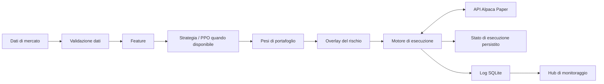

# STMAA — Structural Trading Multi-Agent Architecture

<p align="center">
  
</p>

<p align="center">
  
  
  
  <a href="https://github.com/iFabbro/STMAA/actions/workflows/ci.yml"></a>
  
</p>

STMAA è un framework modulare e sperimentale per la ricerca sul trading sistematico, la generazione dei pesi di portafoglio, il backtesting, i controlli del rischio e l'integrazione con il broker. L'architettura separa la validazione dei dati di mercato, l'elaborazione delle variabili, la generazione delle strategie, i filtri di rischio, l'esecuzione, la persistenza dello stato e il monitoraggio operativo.

**Ambito attuale: ricerca e Alpaca Paper Trading. STMAA non è certificato né presentato come software pronto per la produzione; il punto di ingresso operativo incluso nel repository è configurato esclusivamente per il paper trading.** Il superamento dei test non dimostra la redditività, non elimina i rischi di esecuzione e non certifica l'idoneità a operare con capitale reale.

## Funzionalità attuali

- **Interfaccia basata sui pesi:** le strategie esprimono le allocazioni obiettivo tramite pesi di portafoglio.
- **Integrazione dei dati di mercato:** accesso a barre storiche e quotazioni recenti tramite Alpaca, con controlli pensati per individuare dati mancanti, malformati, incompleti o obsoleti.
- **Controlli del rischio:** vincoli sull'esposizione di portafoglio e delle singole posizioni, controlli relativi al drawdown e logica di overlay del rischio basata sul VIX.
- **Protezioni nell'esecuzione tramite broker:** verifiche sull'account, sugli ordini aperti o pendenti, sulla coerenza tra ordini e posizioni e sui dati necessari a stimare l'esposizione. Quando lo stato necessario non è affidabile, i percorsi interessati sono progettati per bloccare l'operazione invece di inviare un nuovo ordine.
- **Riconciliazione degli ordini:** controlli per gestire aggiornamenti ritardati delle posizioni dopo l'esecuzione, inclusi i riempimenti parziali e le discrepanze non risolte.
- **Persistenza dello stato di esecuzione:** gestione dello stato locale con protezioni per la scrittura atomica, blocco dei processi concorrenti e verifiche contro scritture obsolete.
- **Componenti di backtesting:** motore di ricerca per il backtesting e interfacce condivise basate sui pesi.
- **Visibilità operativa:** registrazione di eventi e sessioni tramite SQLite e interfaccia di monitoraggio da terminale.
- **Test di regressione automatizzati:** copertura di strategie, dati, esecuzione, rischio e scenari di errore.

Queste descrizioni riguardano funzionalità presenti nel codice; non garantiscono che ogni possibile errore di mercato, broker, rete o processo sia coperto. Prima di fare affidamento su un comportamento, esaminare il codice e i risultati CI più recenti.

## Architettura



Il repository contiene codice relativo a PPO, ma la presenza di un agente o di dipendenze per l'addestramento non dimostra che esista un modello addestrato, validato o redditizio. La qualità del modello e le prestazioni della strategia richiedono valutazioni separate.

## Sicurezza e limiti operativi

- Il file `.env.example` configura `STMAA_TRADING_MODE=paper` e l'endpoint API di Alpaca Paper.
- Il punto di ingresso `trade.py` costruisce il broker executor con il paper trading abilitato.
- La configurazione del rischio include `MAX_PORTFOLIO_EXPOSURE` (valore predefinito `0.50`) e `MAX_DRAWDOWN` (valore predefinito `0.15`); i valori vengono validati all'avvio. Altri controlli sono configurati nei moduli di strategia ed esecuzione pertinenti.
- Il percorso di esecuzione include controlli fail-closed per importanti condizioni di errore o indeterminatezza relative a broker, ordini, posizioni, dati di mercato e stato persistito.
- La liquidazione di emergenza al superamento della soglia di drawdown è opzionale e, nel file `.env.example`, è disabilitata per impostazione predefinita.
- Molti scenari di errore vengono verificati tramite mock e stato locale. Un test superato con mock non prova il comportamento end-to-end del broker in tutte le condizioni reali.

**Non configurare questo progetto per un account di broker live e non usarlo per negoziare fondi reali basandosi soltanto su questo README.** Un eventuale supporto futuro al live trading richiederebbe una revisione separata dell'implementazione, protezioni esplicite, test operativi e una validazione indipendente del rischio.

## Demo

<p align="center">
  
</p>

## Requisiti

- Python 3.13 (versione configurata nella CI).
- Git.
- Credenziali Alpaca Paper Trading per i flussi che richiedono dati di mercato o accesso al broker.

## Avvio rapido

Clonare il repository e creare un ambiente Python isolato:

```bash
git clone https://github.com/iFabbro/STMAA.git
cd STMAA
python3.13 -m venv .venv
source .venv/bin/activate
python -m pip install --upgrade pip
pip install -r requirements.txt
```

Creare un file di configurazione locale a partire dal modello:

```bash
cp .env.example .env
```

Inserire in `.env` le credenziali API di **Alpaca Paper Trading**. Non salvare credenziali o altri segreti nel repository. Mantenere la modalità paper e l'endpoint paper, salvo modifiche esplicitamente revisionate.

Eseguire la suite di test usando gli stessi percorsi configurati nella CI:

```bash
python -m pytest src/tests tests -q
```

### Addestramento PPO (ricerca, non paper execution)

Il training usa barre storiche OHLCV aggiustate scaricate da Yahoo Finance, calcola gli indicatori causali e divide i dati cronologicamente: il periodo più recente è riservato alla validazione e non viene usato per l'ottimizzazione PPO.

```bash
PYTHONPATH=. python train.py \\
  --start-date 2018-01-01 \\
  --end-date 2026-01-01 \\
  --total-timesteps 50000 \\
  --validation-fraction 0.2 \\
  --max-position-size 0.20 \\
  --max-gross-exposure 0.50 \\
  --transaction-cost 0.001 \\
  --slippage 0.0005 \\
  --seed 42
```

L'opzione `--end-date` è esclusiva. Il comando produce `models/ppo_trading_model_v3.zip` e il relativo file `.metadata.json`, che registra versione del contratto, ticker, costi, limiti di allocazione, intervalli temporali e metriche sul periodo holdout. I limiti e i costi devono coincidere con quelli del runtime; il caricamento rifiuta un modello con parametri incompatibili. Se `MAX_PORTFOLIO_EXPOSURE` in `.env` è diverso da `0.50`, passare lo stesso valore a `--max-gross-exposure`.

La validazione è diagnostica e non applica una soglia automatica di redditività: un risultato positivo sul periodo holdout non garantisce prestazioni future. Il training non accede al broker e non invia ordini. `trade.py` continua a richiedere un modello compatibile e resta configurato per Alpaca Paper.

Avviare il flusso di paper trading:

```bash
PYTHONPATH=. python trade.py
```

Avviare l'hub di monitoraggio da terminale in una finestra separata:

```bash
PYTHONPATH=. python hub.py
```

Il flusso operativo può richiedere credenziali valide e dati di mercato accessibili. Il semplice avvio corretto non dimostra che la strategia sia redditizia né che tutti gli scenari di esecuzione siano stati validati.

## Struttura del repository

```text
.
├── src/
│   ├── agents/       # Componenti agent e portafoglio
│   ├── backtest/     # Componenti di backtesting
│   ├── data/         # Accesso ed elaborazione dati di mercato
│   ├── execution/    # Broker executor e protezioni di esecuzione
│   ├── strategy/     # Interfaccia dei pesi e overlay del rischio
│   ├── tests/        # Test di regressione automatizzati
│   └── utils/        # Metriche e logging SQLite
├── tests/            # Test aggiuntivi, se presenti
├── scripts/          # Script di supporto e validazione, se presenti
├── trade.py          # Punto di ingresso per il paper trading
├── hub.py            # Hub di monitoraggio da terminale
├── train.py          # Punto di ingresso per l'addestramento
├── requirements.txt
├── .env.example      # Modello di configurazione paper
└── ROADMAP.md        # Roadmap: verificare la coerenza con l'implementazione corrente
```

## Integrazione continua

Il workflow GitHub Actions in [`.github/workflows/ci.yml`](https://github.com/iFabbro/STMAA/blob/main/.github/workflows/ci.yml) esegue la suite automatizzata sui push a `main` e sulle pull request. Per conoscere i controlli effettivi e il loro stato, fare riferimento al workflow e all'esecuzione più recente: questo README non dichiara che uno specifico commit abbia superato la CI.

## Stato dello sviluppo

STMAA rimane in stato **alpha / sperimentale**. Il lavoro in corso comprende l'estensione delle verifiche end-to-end, la riconciliazione dello stato del broker, il calcolo del rischio in presenza di dati incompleti o obsoleti e la distinzione tra funzionalità implementate e obiettivi di ricerca futuri. Reinforcement learning, ottimizzazione del portafoglio ed eventuali capacità future di live trading devono essere valutati separatamente: la loro presenza nella struttura del repository non implica che siano pronti per la produzione.

## Contribuire

1. Creare un branch dedicato e circoscritto.
2. Aggiungere o aggiornare test di regressione per le modifiche comportamentali, in particolare per gli scenari di errore e quelli in cui non deve essere inviato alcun ordine.
3. Eseguire la suite di test e i controlli pertinenti del repository.
4. Aprire una pull request e verificare i risultati CI prima del merge.

## Licenza

STMAA è distribuito con licenza MIT. Consultare il file [`LICENSE`](LICENSE) per i dettagli.


## Broker execution lock and deployment boundary

The broker execution lock is a host-local operating-system file lock (fcntl.flock).
All cooperating STMAA processes on the same host must use the same
STMAA_BROKER_STATE_FILE path on a filesystem that supports advisory locks.
At startup, configured paths are resolved to canonical absolute paths (including
existing symlink targets) before lock-file names are derived.
Lock acquisition is bounded by STMAA_BROKER_EXECUTION_LOCK_TIMEOUT_SECONDS
(default: 30 seconds); timeout or lock errors stop the execution cycle before
broker mutations are attempted.

This mechanism is not a distributed lock and does not coordinate independent
hosts or filesystems. During the current single-host development phase, operate
only one active STMAA executor per broker account. Multi-host execution requires
a separately designed centralized execution service and is outside the scope of
the current implementation.
