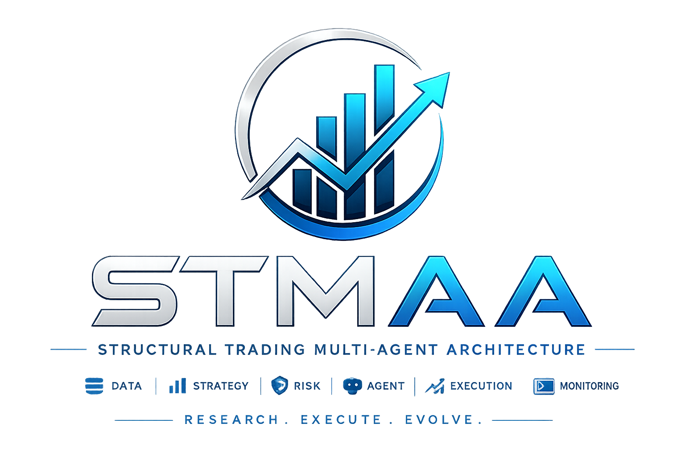
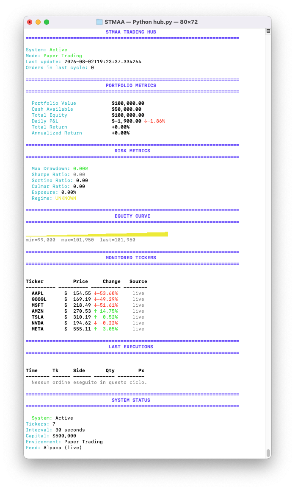
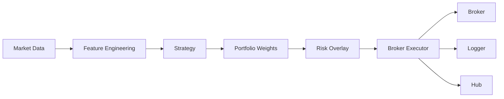

<p align="center">
  
</p>

<p align="center">
  
  
  
  
  
  
  
  
</p>

# STMAA

Structural Trading Multi-Agent Architecture

STMAA is a modular research and execution framework for algorithmic trading. It unifies backtesting, paper trading, and live execution behind a weight-based architecture with built-in risk controls and monitoring.

<p align="center">
  <em>Insert a terminal screenshot or short demo GIF of the hub here.</em>
</p>

## Demo

<p align="center">
  
</p>


## Why STMAA?

Most trading bots couple signal generation, execution, and broker logic in a single workflow.

STMAA separates these responsibilities through a weight-centric architecture where:

- strategies generate portfolio weights,
- risk overlays constrain exposure,
- execution translates weights into broker orders,
- monitoring remains independent from trading logic.

This separation makes research, testing, and deployment easier to manage.

## Overview

STMAA is designed as a modular research and execution framework for algorithmic trading. It keeps strategy logic, portfolio weighting, risk checks, execution, and monitoring separated so each part can evolve independently.

The current focus is a robust paper-trading workflow with broker safeguards, structured logging, and a growing test suite.


The project is designed to keep strategy logic, portfolio weighting, risk checks, and execution concerns separated. That makes it easier to test, debug, and evolve the system without coupling everything into a single trading script.

STMAA currently focuses on a robust paper-trading workflow, broker execution safeguards, structured logging, and a growing test suite.

## Features

- Multi-agent trading architecture.
- Weight-based execution interface.
- Backtesting and paper-trading workflow.
- Broker execution with guardrails.
- SQLite logging for local observability.
- Risk controls for exposure and drawdown.
- Automated test coverage for core modules.
- CLI support for report generation and validation.

## Architecture



## Quick Start

|
| Weight-based execution | ✅ | ❌ |
| Modular architecture | ✅ | ⚠️ |
| Research oriented | ✅ | ⚠️ |
| Integrated backtesting | ✅ | ✅ |
| Risk overlay | ✅ | ⚠️ |
| Monitoring hub | ✅ | ❌ |


### Requirements

- Python 3.10 or newer.
- A virtual environment is recommended.
- Broker credentials for paper trading if you want to test the execution path.

### Setup

```bash
git clone https://github.com/iFabbro/STMAA.git
cd STMAA
python3 -m venv .venv
source .venv/bin/activate
pip install -r requirements.txt
```

### Run the main workflow

```bash
PYTHONPATH=. python3 trade.py
```

### Run the orchestration hub

```bash
PYTHONPATH=. python3 hub.py
```

### Run the test suite

```bash
PYTHONPATH=. python3 -m pytest src/tests -q
```

## Usage

The main entry point is `trade.py`, which executes the trading workflow end to end. The orchestration layer is in `hub.py`, which coordinates the broader system behavior.

Core implementation files include:
- `src/execution/broker_executor.py` for broker access and execution rules.
- `src/utils/sqlite_logger.py` for structured local logging.
- `src/tests/` for automated checks around the most important modules.

## Project Structure

| Component | Role |
|---|---|
| `trade.py` | Operational entry point for the trading workflow. |
| `hub.py` | Main orchestration layer. |
| `src/execution/broker_executor.py` | Broker access, positions, open orders, and execution constraints. |
| `src/utils/sqlite_logger.py` | Structured logging to SQLite. |
| `src/tests/` | Automated tests for the core modules. |
| `scripts/` | Local helper scripts and validation tools. |

## Roadmap

- Improve reconciliation of capital already reserved by accepted orders.
- Expand observability for the execution pipeline.
- Harden broker state and order lifecycle handling.
- Add richer reporting and analysis tools.
- Introduce CI-backed test badges and build verification.
- Add more examples for paper trading and live trading workflows.

## Contributing

Contributions are welcome. Please keep changes focused, run the test suite before opening a pull request, and open a separate `CONTRIBUTING.md` file if you want to document a more detailed workflow.

## License

STMAA is released under the MIT License. See the `LICENSE` file for details.
