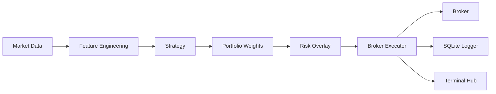

<p align="center">
  
</p>

<p align="center">
  
  
  
  
  
  <a href="https://github.com/iFabbro/STMAA/actions/workflows/ci.yml"></a>
  
</p>

# STMAA
Structural Trading Multi-Agent Architecture

STMAA is a modular research and execution framework for algorithmic trading, currently in active development. The project is built around a weight-centric portfolio interface that separates strategy logic, risk controls, execution, broker communication, and monitoring into independent components.

The same strategy contract is intended to support:

- research
- backtesting
- paper trading
- live execution

## Project Status

STMAA is not a production-ready trading system.

The repository currently reflects an alpha-stage architecture with a working core, active development areas, and several components still under validation or refinement. That includes areas such as reinforcement-learning integration, advanced risk logic, extended market-data handling, and full production hardening.

## Demo

<p align="center">
  
</p>

## Why STMAA?

Most trading bots combine signal generation, execution, broker logic, and monitoring into a single flow.

STMAA instead uses a layered architecture:

- market data feeds the system.
- feature engineering prepares the inputs.
- strategies generate portfolio weights.
- the risk overlay constrains exposure.
- the broker executor transforms weights into orders.
- the broker handles execution.
- logging records system activity.
- the monitoring hub keeps the workflow visible.

Each layer has a single responsibility. This makes the framework easier to extend, test, debug, and evolve as the project matures.

## Features

- Modular multi-agent architecture.
- Weight-centric execution model.
- Execution-consistent backtesting.
- Alpaca paper trading integration.
- Risk overlay.
- SQLite structured logging.
- Terminal monitoring hub.
- Automated test suite.
- DRL-ready architecture.
- Research-oriented design.

## Architecture



## Why STMAA instead of a monolithic trading bot?

| Feature | STMAA | Typical trading bot |
|---|---:|---:|
| Modular architecture | ✅ | ⚠️ |
| Weight-based execution | ✅ | ❌ |
| Risk overlay | ✅ | ⚠️ |
| Execution-consistent backtesting | ✅ | ⚠️ |
| Paper trading | ✅ | ✅ |
| Live execution ready | ✅ | ⚠️ |
| Monitoring hub | ✅ | ❌ |
| Research oriented | ✅ | ⚠️ |

## Quick Start

### Requirements

- Python 3.10 or newer.
- A virtual environment is recommended.
- Alpaca paper trading credentials if you want to test the execution path.

### Setup

```bash
git clone https://github.com/iFabbro/STMAA.git
cd STMAA
python3 -m venv .venv
source .venv/bin/activate
pip install -r requirements.txt
```

### Run the main workflow

```bash
PYTHONPATH=. python3 trade.py
```

### Run the orchestration hub

```bash
PYTHONPATH=. python3 hub.py
```

### Run the test suite

```bash
PYTHONPATH=. python3 -m pytest src/tests -q
```

## Example Session

```text
Loading market data...
Computing indicators...
Generating portfolio weights...
Applying risk overlay...
Submitting paper orders...
Updating hub state...
Cycle completed successfully.
```

## Project Structure

```text
src/
├── agents/
├── backtest/
├── data/
├── execution/
├── strategy/
├── tests/
└── utils/

trade.py
hub.py
ROADMAP.md
```

| Component | Role |
|---|---|
| `trade.py` | Operational entry point for the trading workflow. |
| `hub.py` | Main orchestration layer. |
| `src/execution/broker_executor.py` | Broker access, positions, open orders, and execution constraints. |
| `src/utils/sqlite_logger.py` | Structured logging to SQLite. |
| `src/tests/` | Automated tests for the core modules. |
| `scripts/` | Local helper scripts and validation tools. |

## Current Status

Current development stage:

- Modular architecture in place.
- Weight interface available.
- Risk overlay implemented.
- Backtesting engine present.
- Paper trading workflow available.
- Terminal hub available.
- Structured logging implemented.
- Automated tests in progress and expanding.

Next milestones:

- Real market data.
- DRL policy integration.
- Portfolio optimisation.
- CI/CD pipeline.
- Live trading hardening.
- Historical performance dashboard.

## Known Development Notes

The codebase is evolving, so some areas are intentionally minimal or still being refined.

Typical development items include:

- reward and metric definitions under review.
- RL observation shapes and training interfaces still stabilizing.
- broker/execution safeguards being hardened.
- roadmap and documentation being aligned with the current alpha status.

These are expected in an active development repository and should be treated as implementation work rather than finished production behavior.

## Contributing

Contributions are welcome.

Please:

- Fork the repository.
- Create a feature branch.
- Run the test suite.
- Open a pull request.

## License

Released under the MIT License.
See the `LICENSE` file for details.