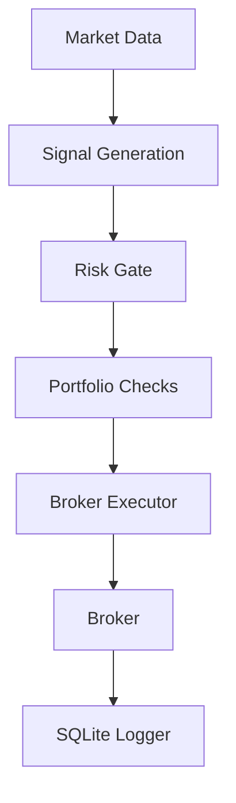

<p align="center">
  
</p>

<p align="center">
  
  
  
  
  
  
  
  
</p>

# STMAA

Structural Trading Multi-Agent Architecture

Sistema di trading/algo-execution con orchestrazione, paper trading, logging, test automatici e controlli di rischio.

Il repository contiene il flusso operativo principale (`trade.py`), l’hub di orchestrazione (`hub.py`), l’integrazione broker (`src/execution/broker_executor.py`) e componenti di supporto per logging, risk controls e test. Il branch `feature/hardening-and-logs` introduce hardening del paper trading, reconciliation del notional impegnato, risk gate minimale e copertura test estesa.

## Perché esiste

STMAA serve a far girare un flusso di trading automatizzato con maggiore robustezza operativa. Gli aggiornamenti recenti hanno migliorato il comportamento in assenza di componenti opzionali, l’uso del buying power reale, la protezione contro ordini duplicati e i controlli di rischio prima dell’esecuzione.

## Stato attuale

Funzionalità e miglioramenti già presenti:

- Fallback sicuro quando un componente PPO non è disponibile.
- Budget di esecuzione più aderente al buying power reale.
- Reconciliation fine del notional già impegnato da ordini `accepted` e `partially_filled`.
- Risk gate minimale con cap su exposure massima e blocco per drawdown.
- Logging SQLite per osservabilità e audit locale.
- Suite test estesa su broker executor, hub e trade.
- Branch remoto pubblicato: `origin/feature/hardening-and-logs`.

## Architettura rapida

| Componente | Ruolo |
|---|---|
| `trade.py` | Entry point operativo del flusso di trading. |
| `hub.py` | Orchestrazione generale del sistema. |
| `src/execution/broker_executor.py` | Accesso al broker, posizioni, open orders, vincoli di esecuzione e risk gate. |
| `src/utils/sqlite_logger.py` | Logging strutturato locale su SQLite. |
| `src/tests/` | Test automatici per i moduli principali. |
| `scripts/` | Script di supporto e verifica locale. |

## Requisiti

- Python 3.10+
- Ambiente virtuale consigliato
- Dipendenze Python del progetto
- Credenziali/configurazione del broker per il paper trading

## Setup rapido

```bash
git clone https://github.com/iFabbro/STMAA.git
cd STMAA
python3 -m venv .venv
source .venv/bin/activate
pip install -r requirements.txt
```

## Esecuzione

Flusso principale:

```bash
PYTHONPATH=. python3 trade.py
```

Hub/orchestrazione:

```bash
PYTHONPATH=. python3 hub.py
```

## Test

Esecuzione completa della suite:

```bash
PYTHONPATH=. python3 -m pytest src/tests -q
```

## Logging e file runtime

Gli artefatti runtime non devono entrare nel repository. Il progetto ignora file come:

- `logs/**/*.json`
- `logs/*.db`
- `*.db`
- `__pycache__/`
- `.pytest_cache/`

I file di stato runtime precedentemente tracciati sono stati rimossi dall’indice Git per evitare rumore nei commit futuri.

## Budget strumenti e servizi

La tabella sotto separa i costi in due categorie: strumenti esterni realmente usati dal workflow e componenti con costo operativo nullo o variabile. TradingView espone un piano Free a $0 e piani non-professionali da $12.95/mese (Essential), $29.95/mese (Plus), $59.95/mese (Premium) e $199.95/mese (Ultimate), tutti con fatturazione annuale ai prezzi mostrati nella pagina pricing; solo Ultimate è disponibile per utenti professionali. Alpaca indica che il paper trading non richiede denaro reale e che il trading API retail self-directed è in generale commission-free, pur con possibili fee regolamentari o casi specifici legati a partner o fee schedule.

| Strumento / servizio | Uso nel progetto | Budget indicativo |
|---|---|---|
| TradingView Free | Analisi base, charting iniziale, osservazione mercati | $0/mese |
| TradingView Essential | Automazioni leggere, più alert e chart | $12.95/mese, billed annually |
| TradingView Plus | Operatività più attiva, più chart e alert | $29.95/mese, billed annually |
| TradingView Premium | Setup avanzato, alert elevati, storico più ampio | $59.95/mese, billed annually |
| TradingView Ultimate | Uso power/professionale ad alto volume | $199.95/mese, billed annually |
| Alpaca Paper Trading API | Esecuzione simulata e test broker | Nessun capitale reale richiesto |
| Alpaca API trading retail | Execution API live/paper | Commission-free in generale per retail self-directed; possibili fee regolamentari o eccezioni |
| OpenAI API | Supporto AI per analisi, automazioni o tool ausiliari | Variabile a consumo; da definire in base al modello e al volume |

### Budget operativo suggerito

Per un setup lean e pragmatico:

- **Minimo**: TradingView Free + Alpaca Paper Trading = $0/mese di piattaforme core, esclusi eventuali costi AI e dati premium.
- **Entry serious**: TradingView Essential + Alpaca Paper Trading = $12.95/mese come base ragionevole per alert e charting migliori.
- **Active builder**: TradingView Plus o Premium + Alpaca = $29.95–$59.95/mese per un flusso più solido lato analisi e monitoraggio.

## Flow decisionale



## Risk controls

Il motore include un risk gate minimale con:
- cap su exposure massima per ciclo;
- blocco automatico se il drawdown supera la soglia;
- reconciliation del capitale già impegnato dagli ordini aperti.

I parametri principali sono `MAX_PORTFOLIO_EXPOSURE` e `MAX_DRAWDOWN`, configurabili via ambiente.

## Convenzioni operative

- Eseguire i test prima di ogni push.
- Non versionare log, database locali e state snapshot runtime.
- Tenere separato il codice di execution dagli artefatti operativi.
- Usare branch tematici per ogni hardening o evoluzione del motore.

## Workflow Git consigliato

```bash
git checkout feature/hardening-and-logs
git pull
PYTHONPATH=. python3 -m pytest src/tests -q
git status
git add <file>
git commit -m "Messaggio chiaro"
git push
```

## Roadmap

Priorità successive già emerse dal lavoro recente:

- Reconciliation più fine dei notional già impegnati da ordini `accepted`.
- Maggiore osservabilità del flusso di execution.
- Hardening aggiuntivo delle logiche di broker state e order lifecycle.
- Documentazione operativa più dettagliata per ambienti paper/live.

## Note

Le sottoscrizioni TradingView possono prevedere tasse aggiuntive in base alla giurisdizione e i market data extra sono acquistabili separatamente dai piani base. Per Alpaca, il paper trading è utile per validare il comportamento del sistema, ma non replica tutti i rischi e le condizioni del trading reale.
